<!-- Animated Wave Header -->
<p align="center">
  
</p>

<!-- Animated Typing SVG -->
<p align="center">
  
</p>

<!-- Profile Views & Badges -->
<p align="center">
  
  
  
  <a href="https://codetoclarity.in" target="_blank"></a>
  <a href="https://kishan-kumar.vercel.app/" target="_blank"></a>
  <a href="https://drive.google.com/file/d/1EUd6wRre03iJJVpXswkKb86-7jvGWeig/view?usp=sharing" target="_blank"></a>
</p>

<!-- Divider -->


## 🧑‍💻 About Me

```yaml
Name: Kishan Kumar
Role: Full Stack .NET Developer | Software Engineer
Blog: codetoclarity.in ✍️ (Decoding System Design & .NET Architecture)
Location: India 🇮🇳
Experience: Developing since 2023 with Agile/Scrum & best engineering practices
Core Expertise: C# · .NET Core · ASP.NET Web API · Angular · React · Azure · SQL
Focus Areas: High-performance Microservices, Scalable Backend Systems & Modern SPAs
Passion: Architecting robust backend architectures & writing clear tech guides 🛠️
Interests: Stock market analysis 📈, financial markets & fintech innovation 💸
Fun Fact: An ambitious engineer who loves to analyze stocks, write tech blogs, and ship clean code 😉
```


## ✍️ Technical Blog & Publications

<p align="center">
  <a href="https://codetoclarity.in" target="_blank">
    
  </a>
</p>

> *Decoding, learning, and simplifying complex software engineering concepts into production-grade clarity.*

I write in-depth technical articles and architectural breakdowns on my blog [**Code to Clarity**](https://codetoclarity.in):
* ⚡ **.NET Core & C# Mastery:** In-depth runtime mechanics, best practices, memory optimizations, and async patterns.
* 🏗️ **System Design & Architecture:** Scalable distributed systems, microservices decoupling, and resilient design.
* 🔐 **Security & Authentication:** Modern authentication flows, OAuth 2.0, JWT token validation, and API security.
* 🐳 **Cloud & DevOps:** Container orchestration with Docker, CI/CD automation, and production deployments.

👉 **[Read the latest articles on CodeToClarity.in →](https://codetoclarity.in)**


## 🛠️ Tech Stack & Tools

#### 💻 Programming Languages


#### ⚙️ Backend & Frameworks


#### 🌐 Frontend Development


#### 🗄️ Databases & Storage


#### ☁️ Cloud & DevOps


#### 🛠️ Tools & Environments


## 💼 Professional Experience & Core Competencies

```
🏢 Full Stack .NET Developer | Software Engineer
│
├── ⚙️ Backend Engineering & Architecture
│   ├── ⚡ C# · .NET Core · ASP.NET Core Web APIs
│   ├── 🏗️ Microservices architecture, Clean Architecture & SOLID principles
│   ├── 📨 Asynchronous messaging & decoupled services with RabbitMQ
│   ├── 🗄️ Relational & NoSQL database design (SQL Server, MySQL, MongoDB)
│   └── 🛡️ Enterprise security: JWT, OAuth2, input validation & data protection
│
├── 🌐 Frontend & Modern Web Applications
│   ├── 🅰️ Dynamic Single Page Applications with Angular & TypeScript
│   ├── ⚛️ Responsive modern UI components with React
│   ├── 🎨 Clean styling with HTML5, CSS3, Bootstrap & responsive layouts
│   └── 📡 Seamless state management & REST API consumption
│
├── ☁️ Cloud, DevOps & Agile Delivery
│   ├── ☁️ Cloud hosting & deployments across Microsoft Azure & AWS
│   ├── 🐳 Containerization & isolated environments using Docker
│   ├── 🔄 CI/CD workflows with GitHub Actions & GitLab CI
│   └── 📋 Agile / Scrum methodologies & sprint-driven delivery
│
└── 💡 Engineering Strengths & Mindset
    ├── ✍️ Tech author & creator of codetoclarity.in (simplifying architecture & .NET)
    ├── 🚀 High-velocity feature delivery with clean, maintainable code
    ├── 🧠 Fast learner quick to master emerging frameworks & patterns
    ├── 📈 Analytical mindset: system diagnostics, financial markets & data
    └── 🤝 Highly collaborative team player with cross-functional execution
```


## 📊 GitHub Stats

<!-- Served from local output branch via GitHub Actions — NEVER breaks! -->
<!-- (Generated automatically by .github/workflows/profile-stats.yml) -->

<!-- Streak Stats -->
<p align="center">
  
</p>

<!-- GitHub Stats + Top Languages side by side -->
<p align="center">
  
  
</p>

<!-- Activity Graph -->
<p align="center">
  
</p>


## 🏆 GitHub Trophies

<p align="center">
  
</p>


## 🐍 Contribution Snake

<picture>
  <source media="(prefers-color-scheme: dark)" srcset="https://raw.githubusercontent.com/KishanKumar3/KishanKumar3/output/github-snake-dark.svg" />
  <source media="(prefers-color-scheme: light)" srcset="https://raw.githubusercontent.com/KishanKumar3/KishanKumar3/output/github-snake.svg" />
  
</picture>


## 📬 Let's Connect!

<p align="center">
  <a href="https://codetoclarity.in" target="_blank"></a>
  <a href="https://linkedin.com/in/kishan-kumar3" target="_blank"></a>
  <a href="https://kishan-kumar.vercel.app/" target="_blank"></a>
  <a href="https://drive.google.com/file/d/1EUd6wRre03iJJVpXswkKb86-7jvGWeig/view?usp=sharing" target="_blank"></a>
  <a href="https://www.leetcode.com/kishankumar3" target="_blank"></a>
  <a href="https://auth.geeksforgeeks.org/user/boom21kishan/profile" target="_blank"></a>
  <a href="https://kaggle.com/kishankumar3" target="_blank"></a>
  <a href="https://github.com/KishanKumar3" target="_blank"></a>
  <a href="https://instagram.com/3kishan3" target="_blank"></a>
</p>

---

<p align="center">
  
</p>

<p align="center">
  
</p>
